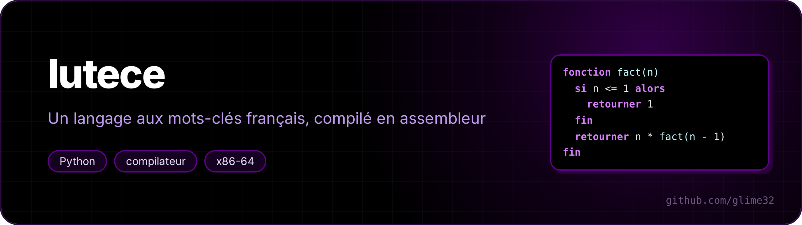

<p align="center"></p>

<p align="center"> </p>

**Lutèce** est un petit langage de programmation aux mots-clés français, et ceci est son **compilateur**, écrit de zéro en Python. Il produit de l'**assembleur x86-64**, que `gcc` transforme en vrai exécutable : pas d'interpréteur, le programme tourne directement sur le processeur.

<p align="center"><a href="README.md">🇬🇧 English version</a></p>

```
# Crible d'Ératosthène
fonction crible(n)
    soit compose = tableau(n + 1)
    soit compte = 0
    pour i de 2 à n faire
        si non compose[i] alors
            compte = compte + 1
            pour j de i * i à n pas i faire
                compose[j] = vrai
            fin
        fin
    fin
    retourner compte
fin

afficher "il y a", crible(10000000), "nombres premiers jusqu'à 10 millions"
```

```sh
$ python3 lutece.py exemples/premiers.lut
il y a 25 nombres premiers jusqu'à 100
il y a 664579 nombres premiers jusqu'à 10 millions
```

## Utilisation

```sh
python3 lutece.py exemples/reines.lut           # compile et lance
python3 lutece.py exemples/reines.lut -o reines # produit l'exécutable
python3 lutece.py exemples/reines.lut -S        # affiche l'assembleur généré
./tests.sh                                      # compile et vérifie tous les exemples
```

Il faut Linux x86-64, Python 3 et `gcc`.

## Le langage

| | |
|---|---|
| `soit x = 3` | déclarer une variable (entier 64 bits) |
| `x = x + 1` | modifier |
| `+ - * / %`, `== != < <= > >=`, `et ou non`, `vrai faux` | opérateurs (`et`/`ou` court-circuitent) |
| `si ... alors ... sinon si ... sinon ... fin` | conditions |
| `tant que ... faire ... fin` | boucle |
| `pour i de 1 à 10 pas 2 faire ... fin` | boucle avec compteur (le pas peut être négatif) |
| `sortir`, `continuer` | quitter la boucle / passer au tour suivant |
| `fonction f(a, b) ... retourner a + b fin` | fonctions, récursives, autant d'arguments qu'on veut |
| `soit t = tableau(100)`, `t[i] = 5` | tableaux (initialisés à 0, bornes vérifiées) |
| `afficher "texte", x, f(x)` | affichage |
| `# ...` | commentaire |

Exemples : [factorielle et Fibonacci](exemples/factorielle.lut), [crible](exemples/premiers.lut), [Syracuse](exemples/syracuse.lut), [n reines](exemples/reines.lut), [Ackermann](exemples/ackermann.lut).

Les erreurs sont expliquées en français, avec la position :

```
programme.lut:4:10: erreur : « f » attend 2 argument(s), pas 1
  afficher f(1)
           ^
```

et à l'exécution : `erreur à la ligne 7 : indice en dehors du tableau`, `division par zéro`.

## Comment marche le compilateur

1. **Analyse lexicale** : une expression régulière découpe le texte en jetons (nombres, noms, mots-clés, opérateurs, fins de ligne).
2. **Analyse syntaxique** par **descente récursive** : une fonction par règle de grammaire (`expr` → `et` → `non` → `comparaison` → `somme` → `produit` → `unaire` → `primaire`), ce qui encode les priorités. Le résultat est un arbre.
3. **Optimisations** sur l'arbre : pliage des constantes (`3 * 4 + x` → `12 + x`), `x + 0` → `x`, suppression des branches mortes (`si faux alors ...`).
4. **Génération de code**. Chaque expression laisse sa valeur dans `rax`. Pour `a + b` : on calcule `b`, on l'empile, on calcule `a`, on dépile `b` dans `rcx`, `add rax, rcx`. Les variables locales vivent sous `rbp` (`[rbp-8]`, `[rbp-16]`...). Les conditions sautent directement (`cmp rax, rcx` puis `jg .Lsinon`) au lieu de fabriquer un booléen.

Voici ce que devient `retourner n * fact(n - 1)` :

```asm
        mov rax, [rbp-8]      ; n
        mov rcx, 1
        sub rax, rcx          ; n - 1
        push rax
        pop rdi               ; 1er argument dans rdi (convention System V)
        call lut_fact
        mov rcx, rax          ; fact(n - 1)
        mov rax, [rbp-8]      ; n
        imul rax, rcx
        jmp .Lretour2
```

### Les détails qui piquent

- **Convention d'appel System V.** Les 6 premiers arguments passent dans `rdi, rsi, rdx, rcx, r8, r9`, les suivants sur la pile ([exemple à 8 arguments](exemples/beaucoup_args.lut)). Et `rsp` doit être un multiple de 16 au moment de chaque `call`, sinon `printf` plante. Le générateur compte les `push` en cours et ajoute 8 octets de cale quand il le faut.
- **`idiv` est piégé.** Il plante sur une division par zéro, mais aussi sur `−2⁶³ / −1`, dont le résultat ne tient pas sur 64 bits. Le code généré teste les deux cas.
- **Division par une puissance de 2.** `idiv` coûte des dizaines de cycles ; `n / 2` devient un décalage. Mais `sar` arrondit vers −∞ alors que la division entière arrondit vers 0 : on ajoute `2^k − 1` aux nombres négatifs avant de décaler. Résultat sur [Syracuse](exemples/syracuse.lut) (un million de suites) : 0,8 s → **0,28 s**, contre 5,4 s pour le même programme en Python.
- **Tableaux.** `tableau(n)` appelle `calloc` pour `n + 1` cases et range la taille dans la case cachée qui précède la première. Chaque accès compare l'indice à cette taille avec une comparaison **non signée** (`jae`) : un indice négatif devient un énorme nombre positif, et il est refusé par le même test.
- **`pour` avec un pas négatif.** La condition de continuation est `i ≤ fin` si le pas est positif, `i ≥ fin` s'il est négatif ; le choix se fait sans branchement, avec `cmovs`.
- **Messages d'erreur à l'exécution.** Avant d'écrire sur `stderr`, la bibliothèque d'exécution vide le tampon de `stdout` : sinon l'erreur s'afficherait avant ce que le programme avait déjà écrit.
