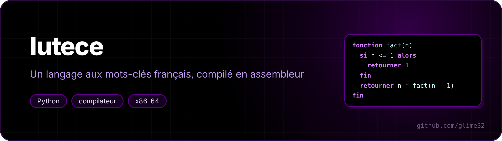

<p align="center"></p>

<p align="center"> </p>

**Lutèce** (the Latin name of ancient Paris) is a small programming language with French keywords, and this is its **compiler**, written from scratch in Python. It outputs **x86-64 assembly**, which `gcc` turns into a real executable: no interpreter, the program runs straight on the CPU.

<p align="center"><a href="README.fr.md">🇫🇷 Version française</a></p>

```
# Crible d'Ératosthène
fonction crible(n)
    soit compose = tableau(n + 1)
    soit compte = 0
    pour i de 2 à n faire
        si non compose[i] alors
            compte = compte + 1
            pour j de i * i à n pas i faire
                compose[j] = vrai
            fin
        fin
    fin
    retourner compte
fin

afficher "il y a", crible(10000000), "nombres premiers jusqu'à 10 millions"
```

*The sieve of Eratosthenes: `fonction` = function, `soit` = let, `pour … de … à … faire` = for … from … to … do, `si … alors` = if … then, `retourner` = return, `afficher` = print.*

```sh
$ python3 lutece.py exemples/premiers.lut
il y a 25 nombres premiers jusqu'à 100
il y a 664579 nombres premiers jusqu'à 10 millions
```

## Usage

```sh
python3 lutece.py exemples/reines.lut           # compile and run
python3 lutece.py exemples/reines.lut -o reines # write the executable
python3 lutece.py exemples/reines.lut -S        # show the generated assembly
./tests.sh                                      # compile and check every example
```

You need Linux x86-64, Python 3 and `gcc`.

## The language

| | |
|---|---|
| `soit x = 3` | declare a variable (64-bit integer) |
| `x = x + 1` | assign |
| `+ - * / %`, `== != < <= > >=`, `et ou non`, `vrai faux` | operators (`et`/`ou` = and/or short-circuit, `non` = not, `vrai`/`faux` = true/false) |
| `si ... alors ... sinon si ... sinon ... fin` | if / else if / else |
| `tant que ... faire ... fin` | while loop |
| `pour i de 1 à 10 pas 2 faire ... fin` | counting loop (the step can be negative) |
| `sortir`, `continuer` | break / continue |
| `fonction f(a, b) ... retourner a + b fin` | functions, recursive, any number of arguments |
| `soit t = tableau(100)`, `t[i] = 5` | arrays (zero-initialised, bounds checked) |
| `afficher "texte", x, f(x)` | print |
| `# ...` | comment |

Examples: [factorial and Fibonacci](exemples/factorielle.lut), [sieve](exemples/premiers.lut), [Collatz](exemples/syracuse.lut), [n queens](exemples/reines.lut), [Ackermann](exemples/ackermann.lut).

Errors are explained in French, with their position:

```
programme.lut:4:10: erreur : « f » attend 2 argument(s), pas 1
  afficher f(1)
           ^
```

and at run time: `erreur à la ligne 7 : indice en dehors du tableau` (index out of bounds), `division par zéro`.

## How the compiler works

1. **Lexing**: a regular expression splits the text into tokens (numbers, names, keywords, operators, line ends).
2. **Parsing** by **recursive descent**: one function per grammar rule (`expr` → `et` → `non` → `comparaison` → `somme` → `produit` → `unaire` → `primaire`), which encodes precedence. The result is a tree.
3. **Optimisations** on the tree: constant folding (`3 * 4 + x` → `12 + x`), `x + 0` → `x`, removal of dead branches (`si faux alors ...`).
4. **Code generation**. Each expression leaves its value in `rax`. For `a + b`: compute `b`, push it, compute `a`, pop `b` into `rcx`, `add rax, rcx`. Local variables live below `rbp` (`[rbp-8]`, `[rbp-16]`...). Conditions jump directly (`cmp rax, rcx` then `jg .Lsinon`) instead of building a boolean.

Here is what `retourner n * fact(n - 1)` becomes:

```asm
        mov rax, [rbp-8]      ; n
        mov rcx, 1
        sub rax, rcx          ; n - 1
        push rax
        pop rdi               ; 1st argument in rdi (System V convention)
        call lut_fact
        mov rcx, rax          ; fact(n - 1)
        mov rax, [rbp-8]      ; n
        imul rax, rcx
        jmp .Lretour2
```

### The tricky bits

- **System V calling convention.** The first 6 arguments go in `rdi, rsi, rdx, rcx, r8, r9`, the rest on the stack ([example with 8 arguments](exemples/beaucoup_args.lut)). And `rsp` must be a multiple of 16 at every `call`, otherwise `printf` crashes. The generator counts the pending `push`es and adds 8 bytes of padding when needed.
- **`idiv` is a trap.** It crashes on a division by zero, but also on `−2⁶³ / −1`, whose result doesn't fit in 64 bits. The generated code checks both cases.
- **Division by a power of 2.** `idiv` costs dozens of cycles; `n / 2` becomes a shift. But `sar` rounds towards −∞ while integer division rounds towards 0: `2^k − 1` is added to negative numbers before shifting. Result on [Collatz](exemples/syracuse.lut) (a million sequences): 0.8 s → **0.28 s**, against 5.4 s for the same program in Python.
- **Arrays.** `tableau(n)` calls `calloc` for `n + 1` cells and stores the size in the hidden cell before the first one. Each access compares the index with that size using an **unsigned** comparison (`jae`): a negative index becomes a huge positive number, and the same test rejects it.
- **`pour` with a negative step.** The loop keeps going while `i ≤ fin` if the step is positive, `i ≥ fin` if it's negative; the choice is made without a branch, with `cmovs`.
- **Run-time error messages.** Before writing to `stderr`, the runtime library flushes the `stdout` buffer: otherwise the error would show up before what the program had already printed.
